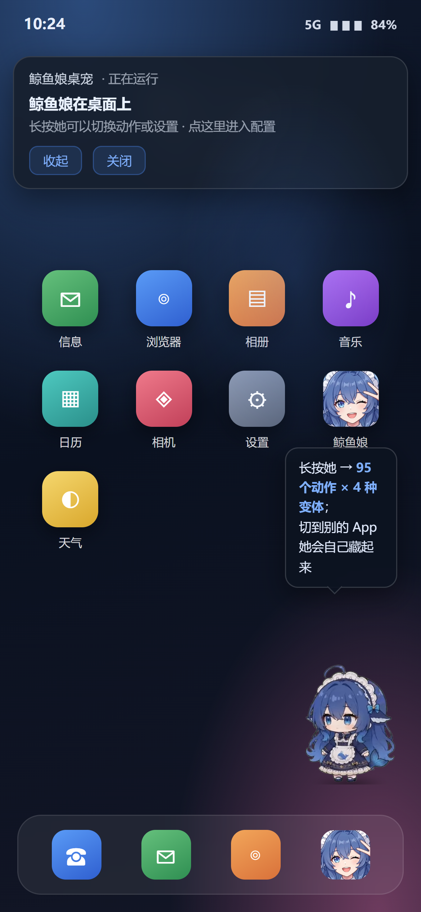

<div align="center">


# 大肥鱼桌宠

把 95 个动作的鲸鱼娘放到 Android 桌面上：系统级悬浮窗常驻、切到别的 App 自动躲起来、长按换动作。

[](https://github.com/zifeiyu243165/WhalePet/releases)
[-3ddc84?style=flat-square)](https://developer.android.com)
[](LICENSE)

[下载安装](#下载安装) · [功能](#功能) · [使用](#使用) · [构建](#从源码构建) · [目录结构](#目录结构) · [素材来源](#素材来源与许可)

</div>



## 这是什么

不是网页套壳：它用系统悬浮窗 `TYPE_APPLICATION_OVERLAY` 浮在桌面上，前台服务常驻，开机自启，
通知栏一键开关。界面上那 95 个动作全是**带 alpha 通道的 VP9 WebM**，靠 `<video>` 直出上屏，
角色之外没有任何底色。

仓库里有两份实现，共用同一套动作目录：

| | 位置 | 说明 |
|---|---|---|
| **Android App**（主要） | `android/` | 悬浮在真桌面上的桌宠，可开机自启、可只显示在桌面、可导入自己的动画 |
| **浏览器版** | `web/` | 单文件 H5，手机浏览器打开「添加到主屏幕」，不用装 App |

## 功能

- **95 个动作 / 16 个分类**：点她、日常、美食、节日、游戏、梗图、打工、魔法……
- **动作库**：长按她弹出，分类浏览、搜索、预览；每个动作有 4 种变体（normal / slow / fast / soft）
- **导入自己的动画**：支持 WebM（带透明）/ MP4 / MKV，导入时自动量一遍 alpha 包围盒，按完整装下缩放居中
- **桌面感知**：只在桌面显示，切到别的 App 自动隐藏，回到桌面立刻出现
- **漫游**：十几秒自己挪一段，走到屏幕边缘会换方向
- **手势**：轻点换动作、按住拖动（松手记住位置）、长按出菜单
- **点击行为三档**：全部动作随机 / 只播「互动反应」 / 不响应
- **可调**：大小（96dp 起）、透明度、开机自启
- **渲染**：`<video>` 原生直出，不经过 canvas 中转（这条是踩了很多坑才定下来的，见 [docs/troubleshooting.md](docs/troubleshooting.md)）

## 下载安装

1. 去 [Releases](https://github.com/zifeiyu243165/WhalePet/releases) 下 `WhalePet-vX.Y.apk`
2. 安装后打开「大肥鱼桌宠」，按页面提示依次放行：
   - **显示在其他应用上层**（悬浮窗权限，必须）
   - **常驻通知**（通知栏一键开关）
   - **忽略电池优化**（锁屏久了不被系统清掉）
   - **使用情况访问**（判断当前是不是桌面，仅在开了「只在桌面显示」时需要）
3. 打开「桌面常驻」开关，鲸鱼就落桌了

> ColorOS / MIUI / HyperOS / EMUI 等国产 ROM 还需要在「自启动管理」「后台运行」里放行本应用，
> 否则重启或长时间后台后可能被杀。

**首次上手**：长按她 → 动作库 → 挑个动作；切到「设置」可以改大小、透明度、点击行为。

### 试试导入动画

`docs/import-demo-star.webm`（480×270 / 30fps / 2.4s / 138KB，透明背景的旋转星星）是配套的测试素材：
长按 → 设置 → **导入动画** → 选它。导入后会出现在动作库最前面的「我的」分类里，格子右上角的 `×` 可以删掉。

想自己造一个：`python scripts/make-test-clip.py`（需要 Pillow 与带 libvpx-vp9 的 ffmpeg）。

## 从源码构建

不需要 Gradle，一条 `aapt2 → javac → d8 → zipalign → apksigner` 的脚本就能出包。

### 需要准备

| 依赖 | 版本 | 用途 |
|---|---|---|
| JDK | 17 | javac / d8 / apksigner / keytool |
| Android build-tools | 34.0.0 | aapt2 / zipalign / lib/d8.jar / lib/apksigner.jar |
| Android platform | 34 | `android.jar` |
| Node.js | ≥ 18 | 生成页面、跑回归测试 |
| Python | 3.x | 把 `classes.dex` 塞进 APK |

把三样 Android 依赖按这个结构放在仓库根的 `.toolchain/` 下（已被 `.gitignore` 排除），
或者用环境变量 `PET_TOOLCHAIN` 指向别处：

```
.toolchain/
├── jdk-17.0.2/
├── android-14/          # build-tools 34，含 aapt2.exe / zipalign.exe / lib/
└── android-34/          # platform 34，含 android.jar
```

### 出包

```bash
bash scripts/build-apk.sh
# => dist/WhalePet-v1.8.apk
```

脚本会：

1. `node scripts/gen-assets.mjs` 把 `web/catalog.json` 内联进 `android/assets/pet.html`
2. `aapt2 compile/link` 打包资源与 assets（`.webm` 不压缩，保持可随机读）
3. `javac -source 8` 编译 `android/src`，`d8 --min-api 26` 转 dex
4. `zipalign -p 4` 对齐，`apksigner` 签 v2+v3

签名：仓库不含密钥。首次构建会在 `keystore/whale.jks` 自动生成一个自签 key（口令 `whale123456`，
可用 `PET_KEYSTORE` / `PET_KS_PASS` 覆盖）。**换成自己的密钥后，无法覆盖安装别人的包。**

> 出于对齐和安装体积考虑，`dist/` 与 `build/` 都不入库，只挂到 Release。

### 浏览器版

```bash
node scripts/gen-assets.mjs     # 生成 web/index.html
node scripts/serve.mjs          # 默认 8000，开完会给手机用的局域网地址
```

## 目录结构

```
WhalePet/
├── android/                    Android 工程（无 Gradle）
│   ├── AndroidManifest.xml
│   ├── pet.template.html       悬浮窗页面模板（构建时内联动作目录成 assets/pet.html）
│   ├── src/com/whale/pet/      MainActivity / PetService / ImportActivity / Prefs / PetContainer / BootReceiver
│   ├── assets/
│   │   ├── media/thumb/        95 个透明 WebM，16 个分类子目录
│   │   └── ui/                 界面贴图
│   └── res/                    布局、图标、主题
├── web/                        浏览器版（模板 + catalog.json + PWA 图标）
├── scripts/
│   ├── build-apk.sh            出 APK
│   ├── gen-assets.mjs          模板 + 目录 → pet.html / index.html
│   ├── fetch-assets.mjs        从 npm CDN 重新拉 95 个动作
│   ├── make-test-clip.py       造透明测试动画
│   ├── bbox.py                 alpha 包围盒测量（裁剪参数就是这么来的）
│   ├── serve.mjs               本地预览服务
│   ├── check-alpha.mjs         透明底排查（三色底截图）
│   └── test-*.mjs              回归测试
├── docs/
│   ├── images/                 README 截图
│   ├── build.md                构建环境细节与排错
│   ├── troubleshooting.md      背景底色与长按菜单的完整排查记录
│   └── import-demo-star.webm   导入动画的测试素材
└── .toolchain/                 本地工具链（不入库）
```

## 测试

回归测试用 Playwright 驱动本机 Edge/Chrome，直接打开生成的 `pet.html` 跑真实交互：

```bash
npm i                 # 只为 playwright-core
npm test              # test-v18（点击行为、菜单开合）+ test-shadow-menu（底色、锚点、alpha）
npm run test:web      # 浏览器版交互巡检（素材走 CDN，需要联网）
npm run alpha         # 三色底截图，肉眼确认角色之外透明
```

`test-v18` 会顺带做源码级断言：启动恢复常驻、手动渲染档位与诊断接口已彻底移除。

## 已知限制

- **只在 OPPO Reno6 Pro+ / ColorOS 13.1 上真机验证过透明与菜单行为**，其他 ROM 的合成路径未逐一验证；如果出现底色，先跑 `npm run alpha` 区分是素材 alpha 残值还是上屏图层被当成不透明纹理
- 需要「使用情况访问」才能判断当前是否桌面，这是系统级权限，必须手动去设置里开
- 国产 ROM 的后台清理策略会杀掉前台服务，需要在自启动/后台白名单里放行
- 动作素材共约 50MB，装完包体 51MB 左右（素材内置，离线可用）
- `web/` 版靠 CDN 取素材，首次加载会慢一些

## 素材来源与许可

代码以 **Apache-2.0** 发布，见 [LICENSE](LICENSE)。

95 个动画素材来自开源项目 [luweiyabo/dsh-whale-pet](https://github.com/luweiyabo/dsh-whale-pet)
（npm 包 `@luweiyabo/dsh-whale-pet@0.1.3`），版权归原作者及原素材作者所有；
授权以上游仓库的 `LICENSE` 与 `THIRD_PARTY_ASSETS.md`（含 CC BY 4.0 等条目）为准。
本仓库只做格式搬运与移动端适配，未修改素材画面；细节见 [NOTICE](NOTICE)。

如果你要商用或再分发，请一并遵守素材原作者的许可。
